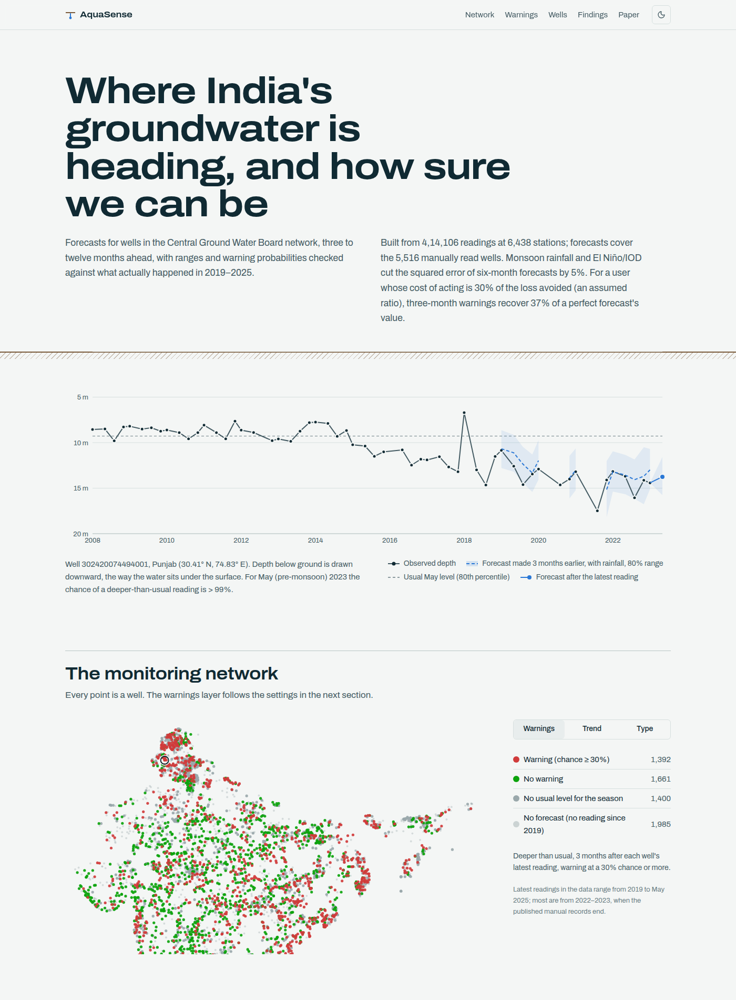

# AquaSense: seasonal groundwater-level forecasts for India

India pumps more groundwater than any other country, and most of its aquifers are refilled only once a year, by
the monsoon. Farmers, district officers and schemes such as the Atal Bhujal Yojana need to know, before the dry
season, how deep the water table will be in a few months, how far to trust that number, and whether a warning is
worth acting on. This project forecasts water levels 3, 6 and 12 months ahead at about 5,000 Central Ground Water
Board (CGWB) monitoring wells, adds uncertainty ranges that are checked separately for shallow and deep wells,
turns them into warnings, and tests all of it on years the models never saw (2019–2025).

## Best verified result

From [RESULTS.md](RESULTS.md), where every number has its metric, test-set size, interval and source file:

- **Forecasting.** Skill means the share of persistence's squared error removed; persistence assumes the level
  stays where it is. The best forecast is an equal-weight combination of gradient boosting, a random forest and
  an LSTM, chosen on the 2016–2018 calibration years. On 2019–2025 it scores **0.534 / 0.590 / 0.235** at 3 / 6 /
  12 months, on 31,468 / 30,424 / 32,472 forecasts. That is **4.2–4.7 % lower squared error than XGBoost** at 3–6
  months (95 % intervals above zero). It is no better than the LSTM alone: the difference is within noise.
- **Monsoon rainfall helps a little, and a perfect rainfall forecast would help more.** Observed rainfall,
  temperature and ENSO/IOD cut 6-month error by 5.0 % [3.3, 6.8], better in 22 of 24 test campaigns. Knowing the
  rain that actually fell would add another 5.5–9.6 %. Real NCEP CFSv2 seasonal forecasts capture none of that.
- **Uncertainty that holds for every kind of well.** One interval width covers 88 % of readings in wells
  shallower than 5 m but only 46 % in wells 40 m or deeper. Intervals pooled by depth and region and updated as
  readings arrive stay within **1.6 / 1.7 / 3.0 percentage points** of the 80 % and 90 % targets for every depth
  and region class.
- **Warnings with economic value, estimated under assumed costs.** No costs were measured. For a user whose cost
  of acting is 30 % of the loss avoided, 3-month "deeper than usual" warnings recover 0.37 [0.34, 0.39] of a
  perfect forecast's value. The value stays positive for cost–loss ratios from 0.04 to 0.92.

The evaluation was audited for leakage ([LEAKAGE_AUDIT.md](LEAKAGE_AUDIT.md)). The audit found no time leakage in
the main evaluation. It fixed one small leak, showed that another did not inflate the results, and withdrew an
earlier claim about the model combination.

## Dashboard



The dashboard is a static React site (`frontend/`) that reads the exported results in `frontend/public/data/`. Its
Models section puts all thirteen models on the same test: a leaderboard with intervals, a card per model, a
head-to-head view of any two models, skill by depth and region, and a replay of each model's forecasts at one well. To
run it locally, use `cd frontend && npm ci && npm run dev`. To publish it, see
[docs/deploy-dashboard.md](docs/deploy-dashboard.md) (GitHub Pages or Vercel).

## How it works

```
CGWB readings (Kaggle copy, data/raw/) ──► ingest: real dates, sign harmonisation, outlier filter, 4 campaigns/year
IMD rain + temperature, NOAA ENSO/IOD   ──► forcing features (trailing windows only; normals fitted ≤ 2015)
NCEP CFSv2 forecasts (IRI)              ──► seasonal-forecast features (issued before each forecast)
                                              │
              time-blocked split by target year: train ≤ 2015 · calibrate 2016–18 · test 2019–25
                                              │
   XGBoost M0 (memory) ⊂ M1 (+ past weather) ⊂ M2 (+ ENSO/IOD) ⊂ M3 (+ future rain, reference only)
   Random Forest · global LSTM · Chronos-2 (zero-shot) · equal-weight combination chosen on 2016–18
                                              │
   conformal intervals by depth × region, updated online ──► warning probabilities, recalibrated on recent outcomes
                                              │
   reports/ (every table and figure) ──► frontend/public/data/ (dashboard)
```

| Path | Content |
|---|---|
| `src/research/` | The pipeline: ingestion, forcing, models, calibration, decision value, leakage audit, dashboard export |
| `tests/research/` | 79 tests, including leakage guards on synthetic data and an end-to-end look-ahead test on the real data |
| `reports/` | Every result table and figure (CSV / JSON / PNG); `reports/audit/` holds the leakage audit |
| `frontend/` | Static dashboard (React, Vite, Tailwind, Recharts) |
| `docs/` | [Data card](docs/data-card.md), [forcing data](docs/forcing-data.md), [dashboard deployment](docs/deploy-dashboard.md) |
| `legacy/` | The original pipeline, kept for the record ([why it was retired](docs/legacy-audit.md)) |

## Reproduce

```bash
conda create -n anpr python=3.12 && conda activate anpr      # any name works: set GW_CONDA_ENV=<name>
pip install -r requirements-research.txt
bash scripts/reproduce.sh                                     # tests → ingest → benchmark, with a reference check
```

That default run was tested on 2026-10-31 from a fresh `git clone` (see below). The full chain adds flags:
`--forcing` downloads IMD and NOAA data (about 1 GB, an hour the first time), and `--phase2 --phase3 --phase4
--phase7 --audit` rebuild every result in the README. That takes several hours and is much faster with a GPU
(Chronos-2, the LSTM). Each stage asserts a reference value and stops if a result changes. The full chain has
been run in the working copy but not yet from a clean clone.

Lint and tests, as in CI (`.github/workflows/ci.yml`):

```bash
ruff check src/research tests
PYTEST_DISABLE_PLUGIN_AUTOLOAD=1 python -m pytest tests/research
```

## Limitations

- **Team project.** This is a three-person B.Tech project; who did each part goes in the next section.
- **Data licence.** The groundwater levels come from a public Kaggle compilation of CGWB data. The compiler and
  download query are not recorded, and its redistribution terms have not been confirmed. The original CGWB /
  India-WRIS data are under the Government Open Data Licence – India. The raw file is in `data/raw/`; check its
  terms before redistributing it ([data card](docs/data-card.md)).
- **Not validated.**
  - Pumping is not observed, so the models cannot separate a pumping response from a climate response.
  - Most manual records end in 2022–2023, so the latest test years are thin.
  - Economic value uses assumed, not measured, costs.
  - Some choices were made after seeing test results. They are labelled as post hoc in the docs: probability
    recalibration, two interval variants and the warning triggers.
  - Squared-error results depend on how gross reading errors are filtered (LEAKAGE_AUDIT §2.1).
  - It is unknown whether Chronos-2's pretraining data included this public compilation.
  - Nothing has been tested with real users, and no forecast has been issued ahead of time.
- **Regions.** Regions are coarse latitude–longitude boxes, not aquifer boundaries. Telemetry (DWLR) wells are
  not used for forecasting.

## My contribution

> _To be written by me: which parts I designed, built and can explain in detail, and which were done by my
> teammates._

## Citation and licence

See [CITATION.cff](CITATION.cff). Code is under the [MIT licence](LICENSE). Results, figures and docs are under
CC BY 4.0. Third-party data in `data/raw/` keep their own terms ([LICENSES.md](LICENSES.md)).

## How this project got here

The first version of this repository reported R² = 0.9998 from a Temporal Fusion Transformer with a pumping
optimiser. An audit found that it had been trained on each borehole's constant construction depth instead of
its water level, so those results were withdrawn. The audit is in [docs/legacy-audit.md](docs/legacy-audit.md), and
the checks behind the current results are in [LEAKAGE_AUDIT.md](LEAKAGE_AUDIT.md).
